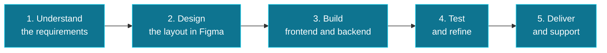

<!-- ================================================================== -->
<!--                                                                    -->
<!--                      SHOAIB NAWAZ - GITHUB PROFILE                 -->
<!--                  github.com/shoaibmhr/shoaibmhr                    -->
<!--                                                                    -->
<!-- ================================================================== -->

<!-- ================================================================== -->
<!--                         1. HEADER / BANNER                         -->
<!-- ================================================================== -->

 

  

  

 

<!-- ================================================================== -->
<!--                         2. QUICK NAVIGATION                        -->
<!-- ================================================================== -->

 

---

<!-- ================================================================== -->
<!--                            3. ABOUT ME                             -->
<!-- ================================================================== -->

## 👨‍💻 About Me

I'm **Shoaib Nawaz**, a Software Engineering student and full-stack web developer from Pakistan.

I build practical, responsive web applications with **React.js**, **Node.js** and **PostgreSQL**. My work ranges from business websites and e-commerce stores to admin dashboards and management systems.

I care about three things in every project:

* 🧼 **Clean code** that is easy to read, maintain and extend
* 📱 **Responsive interfaces** that work smoothly on every screen size
* 🎯 **Real-world value** so that what I build solves an actual business need

I'm now expanding into **AI & Machine Learning**, starting with Python, web scraping and data collection, with the goal of combining web development and AI to build smarter products.

> 💬 *"Build with purpose. Learn through practice. Improve every day."*

 

<!-- ================================================================== -->
<!--                          4. QUICK FACTS                            -->
<!-- ================================================================== -->

### ⚡ Quick Facts

<table>
<tr>
<td width="200"><b>👤 Name</b></td>
<td>Shoaib Nawaz</td>
</tr>
<tr>
<td><b>💼 Role</b></td>
<td>Full-Stack Web Developer</td>
</tr>
<tr>
<td><b>🎓 Education</b></td>
<td>Software Engineering Student</td>
</tr>
<tr>
<td><b>📍 Location</b></td>
<td>Pakistan</td>
</tr>
<tr>
<td><b>🔭 Currently Building</b></td>
<td>Full-stack business applications and admin dashboards</td>
</tr>
<tr>
<td><b>🌱 Currently Learning</b></td>
<td>Python, Web Scraping, AI & Machine Learning</td>
</tr>
<tr>
<td><b>🤝 Open To</b></td>
<td>Internships, freelance projects and collaboration</td>
</tr>
<tr>
<td><b>📫 Reach Me</b></td>
<td><a href="mailto:shoaibmhr895@gmail.com">shoaibmhr895@gmail.com</a></td>
</tr>
</table>

 

<!-- ================================================================== -->
<!--                  5. DEVELOPER STICKER (LEARNING)                   -->
<!--   Upload your sticker as assets/coding.gif (or coding.png) first   -->
<!-- ================================================================== -->

<table>
<tr>
<td width="45%" align="center" valign="middle">

</td>
<td width="55%" valign="middle">

<h3>💻 Always Learning. Always Building.</h3>

Most of my time goes into writing code, building real projects and learning new technologies, one step at a time.

  

</td>
</tr>
</table>

<a href="#top">⬆️ Back to top</a>

---

<!-- ================================================================== -->
<!--                          6. WHAT I DO                              -->
<!-- ================================================================== -->

## 🚀 What I Do

<table>
<tr>
<td width="25%" align="center" valign="top">

### 🎨
### Frontend Development

Responsive, modern user interfaces built with React.js, Tailwind CSS and Bootstrap.

</td>
<td width="25%" align="center" valign="top">

### ⚙️
### Backend Development

REST APIs and server-side logic using Node.js, Express.js and Django.

</td>
<td width="25%" align="center" valign="top">

### 🗄️
### Database Design

Structured data storage, relations and queries using PostgreSQL.

</td>
<td width="25%" align="center" valign="top">

### 📊
### Admin Dashboards

Business portals, management panels and e-commerce platforms.

</td>
</tr>
</table>

 

---

<!-- ================================================================== -->
<!--                           7. SERVICES                              -->
<!-- ================================================================== -->

## 💼 Services I Can Help With

<table>
<tr>
<td width="50%" valign="top">

### 🌐 Business Websites

Professional, fast and mobile-friendly websites that present your business clearly and help customers contact you easily.

* Home, About, Services and Contact pages
* Responsive layout for mobile, tablet and desktop
* WhatsApp and contact form integration
* Clean, modern design

</td>
<td width="50%" valign="top">

### 🛒 E-Commerce Stores

Online stores with product browsing, cart flow and an admin side to manage the catalog.

* Product listing and detail pages
* Cart and checkout flow
* Admin management panel
* Database-backed product data

</td>
</tr>
<tr>
<td width="50%" valign="top">

### 📊 Admin Dashboards

Management portals that help teams and business owners handle data in one place.

* Clean dashboard layouts
* Reusable UI components
* Tables, forms and data views
* Connected to a backend and database

</td>
<td width="50%" valign="top">

### 🔌 Full-Stack Applications

Complete applications where the frontend, backend and database work together.

* React frontend
* Node.js / Django backend
* PostgreSQL database
* REST API integration

</td>
</tr>
</table>

<a href="#top">⬆️ Back to top</a>

---

<!-- ================================================================== -->
<!--                          8. TECH STACK                             -->
<!-- ================================================================== -->

## 🛠️ Tech Stack

<table>
<tr>
<td width="170"><b>🌐 Frontend</b></td>
<td>

</td>
</tr>
<tr>
<td><b>⚙️ Backend</b></td>
<td>

</td>
</tr>
<tr>
<td><b>🗄️ Database</b></td>
<td>

</td>
</tr>
<tr>
<td><b>🤖 AI / Data</b></td>
<td>

</td>
</tr>
<tr>
<td><b>🧰 Tools</b></td>
<td>

</td>
</tr>
</table>

 

### 🎚️ Skill Focus

<table>
<tr>
<td width="33%" valign="top" align="center">

#### 🟢 Core
*What I use most*

React.js 
JavaScript 
HTML & CSS 
Tailwind CSS 
Node.js 
PostgreSQL

</td>
<td width="33%" valign="top" align="center">

#### 🔵 Working Knowledge
*What I have built projects with*

Express.js 
Django 
Bootstrap 
REST APIs 
Git & GitHub 
Figma

</td>
<td width="33%" valign="top" align="center">

#### 🟠 Learning
*What I'm building next*

Python for AI/ML 
Web Scraping 
Data Collection 
Machine Learning 
Data Analysis

</td>
</tr>
</table>

<a href="#top">⬆️ Back to top</a>

---

<!-- ================================================================== -->
<!--                       9. FEATURED PROJECTS                         -->
<!-- ================================================================== -->

## 🌟 Featured Projects

 

<!-- ---------------------- PROJECT 1: FRUITKHA ---------------------- -->

### 🛒 1. Fruitkha: E-Commerce Store

<table>
<tr>
<td width="65%" valign="top">

A full-stack e-commerce store that provides a complete web-based shopping experience. The frontend is built with React, the backend with Django, and the data is stored in a PostgreSQL database.

**Highlights**

* Full-stack architecture with separated frontend and backend
* React.js user interface
* Django backend handling application logic
* PostgreSQL database for structured data

</td>
<td width="35%" valign="top" align="center">

**Tech Used**

  

  

</td>
</tr>
</table>

 

<!-- -------------------- PROJECT 2: ARTBYADEEL ---------------------- -->

### 🎨 2. ArtbyAdeel.com: Business Website

<table>
<tr>
<td width="65%" valign="top">

A live, frontend-focused business website built with React.js. It showcases the business and its offerings, and lets customers contact the business through WhatsApp to request information and place orders.

**Highlights**

* Live production website
* Business-focused, user-friendly browsing experience
* WhatsApp integration for customer inquiries and orders
* Responsive layout built with React.js

</td>
<td width="35%" valign="top" align="center">

**Tech Used**

  

  

</td>
</tr>
</table>

 

<!-- ----------------------- PROJECT 3: NEXDINE ---------------------- -->

### 📊 3. NexDine: Dashboard UI

<table>
<tr>
<td width="65%" valign="top">

A frontend dashboard project built with React.js, focused on dashboard layouts, interface organization and reusable UI components.

**Highlights**

* Dashboard-focused interface design
* Organized application layout
* Reusable React components
* Interactive frontend experience

</td>
<td width="35%" valign="top" align="center">

**Tech Used**

  

  

</td>
</tr>
</table>

 

<!-- ---------------------- PROJECT 4: BLENDBREW --------------------- -->

### ☕ 4. BlendBrew: Coffee Shop Website

<table>
<tr>
<td width="65%" valign="top">

A full-stack coffee shop website built with React.js on the frontend and Node.js on the backend. The project demonstrates how I combine frontend interfaces with backend application functionality for a business concept.

**Highlights**

* React.js frontend
* Node.js backend
* Full-stack development workflow
* Built around a real coffee shop business concept

</td>
<td width="35%" valign="top" align="center">

**Tech Used**

  

  

</td>
</tr>
</table>

 

<!-- ------------------------ PROJECT 5: SARAB ----------------------- -->

### 🍽️ 5. Sarab: Restaurant Management System

<table>
<tr>
<td width="65%" valign="top">

A restaurant website with a management system designed to handle restaurant operations from an admin side.

**Highlights**

* Restaurant management focused workflow
* Admin-side management system
* Business-oriented application design

</td>
<td width="35%" valign="top" align="center">

**Tech Used**

  

  

</td>
</tr>
</table>

 

<a href="#top">⬆️ Back to top</a>

---

<!-- ================================================================== -->
<!--                     10. REPOSITORY SHOWCASE                        -->
<!-- ================================================================== -->

## 📌 Repository Showcase

<a href="#top">⬆️ Back to top</a>

---

<!-- ================================================================== -->
<!--                        11. HOW I WORK                              -->
<!-- ================================================================== -->

## 🔄 How I Work

 

<table>
<tr>
<td width="20%" valign="top" align="center">

### 🧠
**Understand**

Clarify what the business needs before writing any code.

</td>
<td width="20%" valign="top" align="center">

### 🎨
**Design**

Plan the layout and user flow so the interface feels natural.

</td>
<td width="20%" valign="top" align="center">

### 💻
**Build**

Develop the frontend, backend and database with clean, organized code.

</td>
<td width="20%" valign="top" align="center">

### 🧪
**Test**

Check responsiveness, functionality and edge cases.

</td>
<td width="20%" valign="top" align="center">

### 🚀
**Deliver**

Hand over a working product and stay available for improvements.

</td>
</tr>
</table>

 

### 📏 Development Principles

* ✅ Write readable code with meaningful names
* ✅ Keep components small, reusable and focused
* ✅ Design mobile-first, then scale up
* ✅ Use Git with clear, descriptive commits
* ✅ Keep the user experience simple and consistent
* ✅ Keep learning and improving with every project

<a href="#top">⬆️ Back to top</a>

---

<!-- ================================================================== -->
<!--                        12. LEARNING ROADMAP                        -->
<!-- ================================================================== -->

## 🗺️ Learning Roadmap

```mermaid
flowchart LR
    A["HTML • CSS • JavaScript"] --> B["React.js"]
    B --> C["Node.js • PostgreSQL"]
    C --> D["Full-Stack Projects"]
    D --> E["Python • Web Scraping"]
    E --> F["Machine Learning"]
    F --> G["AI-Powered Web Apps"]

    style A fill:#0E7490,stroke:#22D3EE,color:#fff
    style B fill:#0E7490,stroke:#22D3EE,color:#fff
    style C fill:#0E7490,stroke:#22D3EE,color:#fff
    style D fill:#0E7490,stroke:#22D3EE,color:#fff
    style E fill:#B45309,stroke:#F59E0B,color:#fff
    style F fill:#334155,stroke:#64748B,color:#fff
    style G fill:#334155,stroke:#64748B,color:#fff
```

> 🔵 Completed &nbsp;|&nbsp; 🟠 In progress &nbsp;|&nbsp; ⚫ Up next

 

### 🎯 Goals

- [x] Learn HTML, CSS and JavaScript
- [x] Build responsive interfaces with React.js
- [x] Create full-stack applications with a backend and database
- [x] Deliver projects for real businesses
- [ ] Learn Python for data collection and web scraping
- [ ] Understand Machine Learning fundamentals
- [ ] Build a project that combines web development and AI
- [ ] Contribute to open-source projects
- [ ] Grow my portfolio with more real-world applications

<a href="#top">⬆️ Back to top</a>

---

<!-- ================================================================== -->
<!--                        13. CURRENT FOCUS                           -->
<!-- ================================================================== -->

## 🎯 Current Focus

<table>
<tr>
<td width="50%" valign="top">

### 🔭 Building

* Full-stack business web applications
* Admin dashboards and management portals
* Clean, responsive user interfaces
* Real-world projects for clients

</td>
<td width="50%" valign="top">

### 🌱 Learning

* Python for data collection and web scraping
* Machine Learning fundamentals
* Writing cleaner, more maintainable code
* Combining web development with AI

</td>
</tr>
</table>

 

<b>🔽 More about what I'm looking for</b>

 

I'm looking for opportunities where I can:

* Work on real products alongside experienced developers
* Take ownership of features from design to deployment
* Learn modern tools, workflows and best practices
* Grow from web development into AI-powered applications

If you're hiring for an internship or junior role, or need a developer for a freelance project, I'd love to hear from you.

<b>🔽 My development setup</b>

 

| Category | Tool |
|----------|------|
| Editor | VS Code |
| Version Control | Git & GitHub |
| Design | Figma |
| API Testing | Postman |
| Frontend | React.js, Tailwind CSS |
| Backend | Node.js, Express.js, Django |
| Database | PostgreSQL |

<a href="#top">⬆️ Back to top</a>

---

<!-- ================================================================== -->
<!--                       14. GITHUB ANALYTICS                         -->
<!-- ================================================================== -->

## 📈 GitHub Analytics

 

  

  

<a href="#top">⬆️ Back to top</a>

---

<!-- ================================================================== -->
<!--                          15. CONTACT                               -->
<!-- ================================================================== -->

## 🤝 Let's Connect

I'm open to **internships**, **freelance work** and **collaboration** on meaningful projects. If you have an idea, a project or an opportunity, feel free to reach out.

<table>
<tr>
<td width="33%" align="center" valign="top">

### 💼
**LinkedIn**

Connect with me professionally.

</td>
<td width="33%" align="center" valign="top">

### 📧
**Email**

Send me a message directly.

</td>
<td width="33%" align="center" valign="top">

### 🐙
**GitHub**

Follow my work and projects.

</td>
</tr>
</table>

 

<!-- ================================================================== -->
<!--                            FOOTER                                  -->
<!-- ================================================================== -->

 

 

