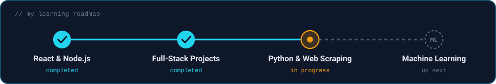

 

### Welcome to my GitHub profile 👋

  

---

## 👨‍💻 About Me

I'm **Shoaib Nawaz**, a Software Engineering student and full-stack web developer from Pakistan. I build practical, responsive web applications with **React.js**, **Node.js** and **PostgreSQL**, from business websites to admin dashboards and e-commerce platforms.

I focus on clean code, real-world projects, and interfaces that are simple to use. I'm now expanding into **AI & Machine Learning**, starting with Python, data collection and web scraping.

<table>
<tr>
<td>

🔭 **Working on:** Full-stack business applications and admin portals 
🌱 **Learning:** Python for AI/ML, web scraping, data handling 
🎯 **Goal:** Build production-quality products and grow into AI-powered applications 
🤝 **Open to:** Internships, freelance projects and collaboration

</td>
</tr>
</table>

---

## 🛠️ Tech Stack

<table>
<tr>
<td width="160"><b>Frontend</b></td>
<td>

</td>
</tr>
<tr>
<td><b>Backend</b></td>
<td>

</td>
</tr>
<tr>
<td><b>Database</b></td>
<td>

</td>
</tr>
<tr>
<td><b>AI / Data</b></td>
<td>

</td>
</tr>
<tr>
<td><b>Tools</b></td>
<td>

</td>
</tr>
</table>

---

## 🌟 Featured Projects

<table>
<tr>
<td width="50%" valign="top">

### 🛒 Fruitkha — E-Commerce Store

Full-stack e-commerce store with a React frontend, Django backend and PostgreSQL database.

  

</td>
<td width="50%" valign="top">

### 🎨 ArtbyAdeel.com — Business Website

Live business website built with React.js. Customers can browse the offerings and place inquiries and orders directly through WhatsApp.

  

</td>
</tr>

<tr>
<td width="50%" valign="top">

### 📊 NexDine — Dashboard UI

React dashboard focused on clean layouts, organized interface structure and reusable UI components.

  

</td>
<td width="50%" valign="top">

### ☕ BlendBrew — Coffee Shop Website

Full-stack coffee shop website with a React frontend and Node.js backend, built as a real client-style project.

  

</td>
</tr>

<tr>
<td width="50%" valign="top">

### 🍽️ Sarab — Restaurant Management System

Restaurant management website with an admin-side system for handling restaurant operations.

  

</td>
<td width="50%" valign="middle" align="center">

### 🔎 More Projects

Explore all my repositories, including raw-material marketplace designs, React apps and more.

 

</td>
</tr>
</table>

---

## 🤖 Learning Roadmap: Web Development → AI & Machine Learning

* 🐍 Python fundamentals for data work (requests, BeautifulSoup)
* 🗂️ Collecting and preparing datasets for AI/ML
* 🧠 Machine Learning basics, then applying them to web projects

---

## 🤝 Let's Connect

I'm open to internships, freelance work and collaboration on meaningful projects. Feel free to reach out.

  

<i>"Build with purpose. Learn through practice. Improve every day."</i>

